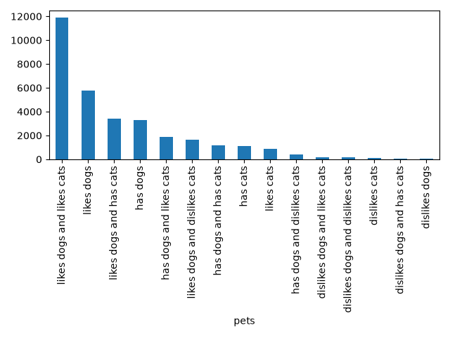

::: {.column-margin}

## Code

<ul>
<li><a href=""> Demo Notebook</a></li>
<li><a href="" download> Demo Data</a></li>
</ul>

## Slides

- [\ PDF Slides](/slides/08-fancy-processing.pdf)
- [\ HTML Slides](/slides/08-fancy-processing.html)

:::

## <!--fit-->DATA 3464: Fundamentals of Data Processing
### <!--fit-->Fancy feature transformations

Charlotte Curtis
October 22, 2026

## Topic overview
* More complex categorical encoding
  - High cardinality
  - Infrequent categories
* More complex numerical transformations
  - 1:many
  - many:many

## The data process to date
\

* We've covered one-hot and ordinal encoding
* We've covered 1:1 numerical transformations

<div data-marpit-fragment>

> Sometimes getting fancy is the answer

</div>

## Potential problems with one-hot encoding
* One-hot encoding creates one column per category
* High cardinality implies some categories are infrequent
* Extreme case: $N$ samples have $N$ unique categories
* Very sparse matrix can cause numerical stability, high computation

<div data-marpit-fragment>

> Either we make it ordinal somehow, or we need to combine categories

</div>

## Combining categories
<!-- _class: code_reminder -->

\
- Even without high cardinality, might want to merge low frequency categories
- Pass `max_categories` as a constraint to `OneHotEncoder`

## Another approach: target encoding
<!-- _class: code_reminder -->
* Basic concept: replace the category with the mean of the target
* Must be [very careful](https://scikit-learn.org/stable/modules/preprocessing.html#target-encoder) during training to avoid data leakage!
* Example: predicting weight of animal

<div class="centred">

| Animal |     | mean_kg |
| ------ | --- | ------- |
| cat    | →   | 4.1     |
| dog    | →   | 15.4    |
| rabbit | →   | 2.2     |

</div>

<!--
Drawbacks
* Doesn't work for unsupervised
* Loss of relationship with other features
* Mean is not great for categories with few examples
-->

## Getting fancy with feature hashing
<!-- _class: code_reminder -->
* Good if you have too many categories, or combinations of categories
* Converts each category into a fixed-length feature vector

<div class="centred">

| Animal |     | A_0 | A_1 | A_2 | ... | A_16 |
| ------ | --- | --- | --- | --- | --- | ---- |
| cat    | →   | 1   | 0   | 0   | ... | 1    |
| dog    | →   | 0   | 1   | 0   | ... | 1    |
| rabbit | →   | 1   | 0   | 1   | ... | 0    |

</div>

> Even fancier methods exist, like [supervised encoding methods](http://www.feat.engineering/categorical-supervised-encoding) which basically train a model-within-a-model


## Advantages/disadvantages

<div class="columns">
<div>

### Target encoding

<span class="pro">

* Powerful if strong predictor
* Compact

</span>
<span class="con">

* Doesn't work for unsupervised
* Central tendency poor measure for categories with few samples
* Difficult to deal with novel categories

</span>
</div>
<div>

### Feature hashing

<span class="pro">

* Natively handles novel categories
* Compact (fixed columns/features)
* Good for high cardinality

</span>
<span class="con">

* Risk of hash collision
* Loss of interpretability/meaning

</span>
</div>
</div>

## <!-- fit --> Fancy numeric transformations

<!-- _class: title_slide -->

## 1:many transformations
* So far our numeric transformations have been 1:1
* 1:many creates multiple features from 1, like binning
* **Basis expansion** introduces nonlinearity to a continuous feature, e.g.:
  $$x \rightarrow [\beta_1x, \beta_2x^2, \beta_3x^3]$$
* More exciting is the **spline** version where you can define different polynomials for different ranges of $x$

<footer>Full disclosure: I have never used this approach</footer>

## many:many transformations

\
* Linear projection methods create new features:
  $$X^* = XA$$
  where $A$ is the *projection matrix* and $X^*$ is the transformed data
* We can use this for **dimensionality reduction** by only keeping some of $X^*$
* Example: Principle component analysis (PCA) finds the set of orthogonal vectors that explain the most variance

<footer>Figure from <a href="https://en.wikipedia.org/wiki/Principal_component_analysis">Wikipedia</a></footer>

## Variance and covariance - Review (?)
<!-- _class: code_reminder -->
* The **variance** of a single feature $\mathbf{x}$ is:
  $$\mathrm{var}(\mathbf{x}) = \frac{\sum_1^n (x_i - \mu_x)^2}{n}$$
* The **covariance** between two features $\mathbf{x_1}$ and $\mathbf{x_2}$ is:
  $$\mathrm{cov}(\mathbf{x_1}, \mathbf{x_2}) = \frac{\sum_1^n (x_{1i} - \mu_{x_1})(x_{2i} - \mu_{x_2})}{n}$$
* Independent variables will have low covariance, but low covariance does not necessarily mean independence!

  <footer>Or divide by <em>n-1</em> for an unbiased estimate of the population variance</footer>

## Covariance matrix
* The **covariance matrix** between all features in a matrix $X$ is:
  $$\mathrm{cov}(X) = \begin{bmatrix} \mathrm{var}(\mathbf{x_1}) & \mathrm{cov}(\mathbf{x_1}, \mathbf{x_2}) & \cdots & \mathrm{cov}(\mathbf{x_1}, \mathbf{x_m}) \\ \mathrm{cov}(\mathbf{x_2}, \mathbf{x_1}) & \mathrm{var}(\mathbf{x_2}) & \cdots & \mathrm{cov}(\mathbf{x_2}, \mathbf{x_m}) \\ \vdots & \vdots & \ddots & \vdots \\ \mathrm{cov}(\mathbf{x_m}, \mathbf{x_1}) & \mathrm{cov}(\mathbf{x_m}, \mathbf{x_2}) & \cdots & \mathrm{var}(\mathbf{x_m}) \end{bmatrix}$$

* Just like regular variance, covariance scales with the data
* If you normalize this, you get the **correlation matrix**

## Back to PCA
* Principle component analysis, proposed in 1901 by [Karl Pearson](https://en.wikipedia.org/wiki/Karl_Pearson), is a linear projection of multidimensional data onto the axes of maximum variance
* The axes are found by **eigendecomposition** of the correlation matrix:
  $$C = Q\Lambda Q^{-1}$$
* The eigenvectors $Q$ form the new orthogonal basis for the correlation matrix $C$, while the eigenvalues $\Lambda$ represent the amount of variance "explained"
* $X^*$ can be calculated as:
  $$X^* = XQ$$

## Dimensionality reduction with PCA
<!-- _class: code_reminder -->

* Sort in order of decreasing eigenvalue ("amount of variance explained")
* Keep only the first $k$ eigenvectors to form $Q_k$
* Project data onto this smaller basis:
  $$X^* = XQ_k$$
* Implemented in Scikit-learn by passing `n_components` to `PCA()`, e.g.
  ```python
  pca = PCA(n_components=2) # just two axes
  X_reduced = pca.fit_transform(X)
  ```

## Linear discriminant analysis (LDA)
* Similar to PCA, but **supervised**
* Finds basis that maximize **class separability**
* Number of projection vectors must be `<= min(n_classes - 1, n_features)`
* Still uses projections and eigenvalues, but adds some statistical magic
* Key assumptions: 
  - Features are normally distributed within a class
  - Classes have identical covariance matrices
* Implemented in Scikit-learn as [LinearDiscriminantAnalysis](https://scikit-learn.org/stable/modules/generated/sklearn.discriminant_analysis.LinearDiscriminantAnalysis.html)

## Other methods
* It seems crazy, but [random projections](https://scikit-learn.org/stable/modules/random_projection.html) can work to reduce dimensionality
* Another many:many transformation that has gained popularity in the "Deep Learning era" is the **autoencoder**
* These are (typically) neural networks that learn a lower-dimensional representation by training the output to match the input
* The "bottleneck" layer in the middle is the reduced representation
* During inference, the model is chopped in half

<!-- draw  on the board -->

## Pros and cons of dimensionality reduction

<!-- Discussion time -->

<div class="columns">
<div>

### Pros
* Can improve model by:
  - removing noise
  - reducing collinearity
* Lower complexity/compute cost
* Can help with visualization
* Can be informative about features

</div>
<div>

### Cons
* Throwing out information
* Harder to interpret results
* May not actually improve anything

</div>
</div>

> Higher list of pros, but still... don't do it unless it's demonstrably beneficial

## Coming up next
- Lab: build a model with the housing data
- Assignment 2: EDA, I look forward to seeing what you discover
- Lecture: Feature interactions
