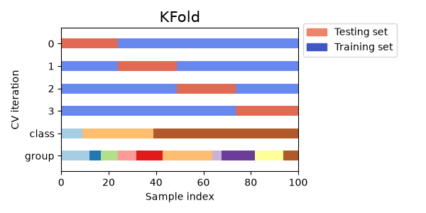
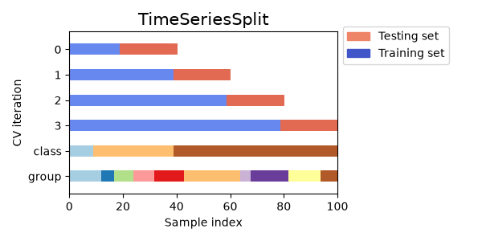
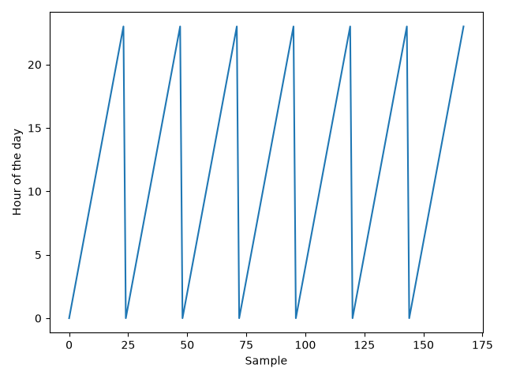

<!-- _class: title_slide -->

## <!--fit-->DATA 3464: Fundamentals of Data Processing
### <!--fit-->Handling Time Series Data

Charlotte Curtis
November 17, 2026

## Topic overview
- Mini lecture on handling time series data
  - What to look out for
  - Splitting
  - Cyclical encoding

### Resources used:
- Hands on Machine Learning with Scikit-Learn and Tensorflow/PyTorch, Chapter 13. Available at [MRU Library](https://ebookcentral.proquest.com/lib/mtroyal-ebooks/detail.action?docID=30168989)
- Scikit-Learn user guide: [Time-related feature engineering](https://scikit-learn.org/stable/auto_examples/applications/plot_cyclical_feature_engineering.html)

## Time Series Data
* Basically, anything that is measured over time is a time series
  - Stock prices
  - Weather data
  - Animal encounters
* Depending what you want to do with it, you need to handle with care
  - Retrospective EDA: no issues
  - Predictive modelling: proceed with caution

<div data-marpit-fragment>

> What are some examples of datasets we've looked at? Are they time series?

</div>

## Considerations
<!-- _class: code_reminder -->

* **Causality**: any predictions must *only* use data from the past
  - The "past" is relative to your validation/test data, not "now"
* **Autocorrelation**: Samples at $t$ tend to be correlated with those at $t-1$
  - This means that current and future values are dependent on past values
* **Stationarity**: A stationary process has stable stats over time
  - If your data is stationary and represents independent events, you *may* be able to ignore the time factor

<div data-marpit-fragment>

> Which of our examples need special time series treatment?

</div>

<footer>MATH 3454 is all about time series — we're not covering forecasting in this course</footer>

## Splitting
* To avoid both causality problems and autocorrelation issues, always split time series data **chronologically** instead of randomly
* This can just be a simple indexing operation:
  ```python
  split = int(0.8 * len(df)) # find the index at around 80% of the data
  train, test = df[:split], df[split:]
  ```
* Do the same thing for validation, or use `cv=TimeSeriesSplit()` if cross-validating

  <div class="columns">

  
  
  

  </div>

## Cyclical Encoding




* Many time-related features are **cyclical**
* Naive ordinal encoding results in unequal jumps between adjacent samples
* Common solution: trig encoding
  $$h_{cos} = \cos\left(\frac{2\pi h}{24}\right)$$
  $$h_{sin} = \sin\left(\frac{2\pi h}{24}\right)$$

## Coming up next
- More "time series" type data: audio signals
- Wednesday lab on regular expressions
- Assignment 3
- Another written test!